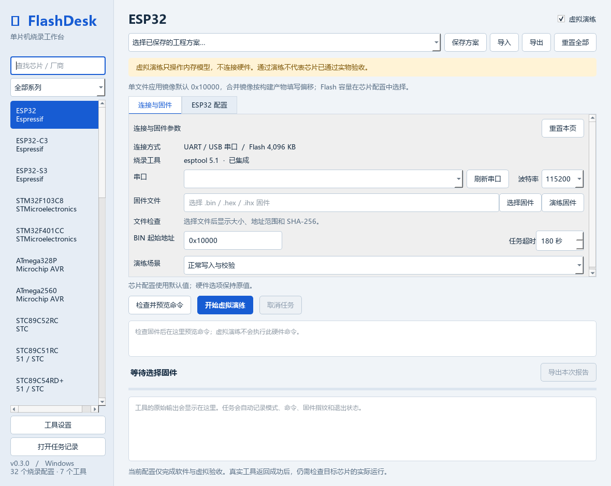
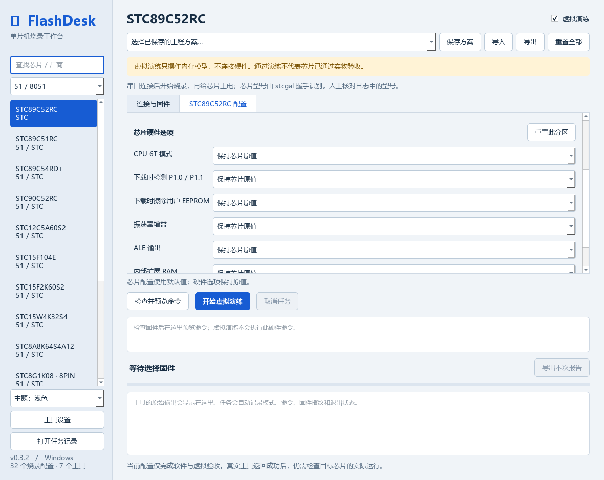
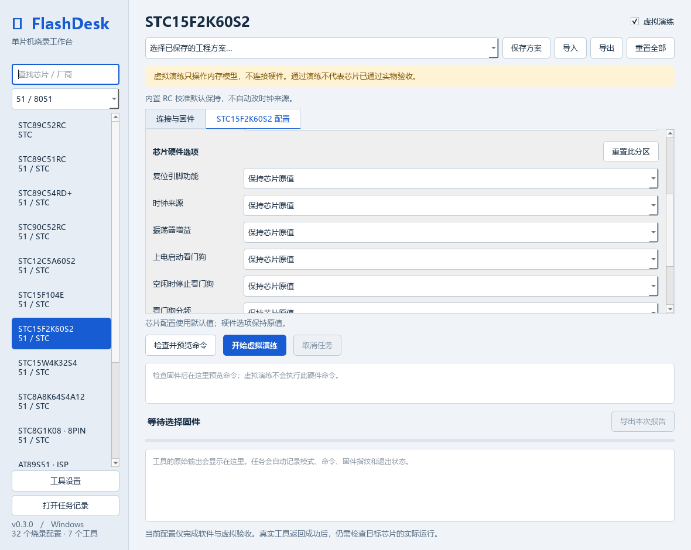

<h1 align="center">FlashDesk</h1>

<p align="center"><strong>单片机烧录工作台</strong></p>
<p align="center">整合成熟烧录工具，让芯片选择、参数配置、固件检查和任务记录在一个窗口里完成。</p>

<p align="center">
  
  
  
  
</p>

<p align="center">
  <a href="#开始使用">开始使用</a> ·
  <a href="docs/USAGE.md">详细使用说明</a> ·
  <a href="docs/acceptance.md">验收记录</a> ·
  <a href="THIRD_PARTY.md">第三方工具</a>
</p>

> 当前为开发预览版：已完成软件与有限协议测试，尚未进行实物芯片验收。芯片预设不等于已认证的硬件兼容清单。

## 一个工作台，多种芯片

- **按芯片显示配置**：32 个烧录配置、7 类工具；ESP、STM32、AVR、51 / 8051 分类筛选，接口变化时自动调整字段。
- **分区独立重置**：连接、Flash、写入、熔丝、STC 硬件选项可以分别恢复默认值。
- **工程方案复用**：保存、更新、导入和导出配置；切换芯片保留当前窗口中的各自草稿。
- **写入前检查**：BIN / Intel HEX（含 SDCC 的 IHX）、地址范围、HEX 校验和、固件指纹，以及独立 EEPROM 文件检查。
- **过程可追溯**：命令预览、原始日志、取消、超时和任务报告。
- **没有开发板也能演练**：在内存模型中验证流程，并测试连接失败、校验失败和工具超时。

## 实际界面



<details>
<summary>查看 STC89 分区配置与重置按钮</summary>



</details>

<details>
<summary>查看新增的 51 分类与 STC15 配置</summary>



</details>

## 芯片与工具

| 系列 | 当前预设 | 后端 | 配置示例 |
|---|---|---|---|
| ESP | ESP8266、ESP32、C3、S3、C6 | 内置 esptool 5.1.0 | Flash 容量 / 模式 / 频率、压缩、连接复位 |
| STM32 | F103C8、F401CC | 外部 STM32CubeProgrammer CLI | 接口、探针、复位、校验；F401CC 可选 DFU |
| STM32 | F103C8、F401CC、F407VG | 外部 OpenOCD 0.12.x | ST-LINK / CMSIS-DAP、SWD 频率、校验与复位 |
| STM32 UART | F103C8、F401CC | 外部 stm32flash | BIN 地址、串口格式、涉及页擦除、重试与校验 |
| AVR | ATmega8 / 16 / 32 / 328P / 2560、ATtiny85 | 外部 AVRDUDE | ISP、EEPROM、适用的熔丝；328P / 2560 另有串口 Bootloader |
| STC 51 | STC89C51RC / C52RC / C54RD+、STC90C52RC、STC12C5A60S2、STC15F104E / F2K60S2 / W4K32S4、STC8A8K64S4A12、STC8G1K08-8PIN | 内置 stcgal 1.10 | 按型号区分协议和硬件选项、冷启动握手、EEPROM；STC8G 为实验性支持 |
| Atmel 51 ISP | AT89S51、AT89S52 | 外部 AVRDUDE 8.1+ | 兼容 8051 的编程器与 ISP 时钟；无 AVR 熔丝 |
| Atmel 51 并行 | AT89C51、AT89C52 | 外部 MiniPro CLI | 封装、短固件、写后校验；需兼容编程器和芯片座 |

32 是芯片与工具组合的配置数，其中 14 个为 51 / 8051 配置；同一 STM32 的不同工具分别列出。外部工具需自行安装可在 Windows 运行的 CLI，再到「工具设置」选择 EXE，并保留原配套文件。新增的三个外部适配器尚未完成本机实际 CLI 联调。[完整配置清单](docs/SUPPORT.md) · [51 初学者说明](docs/8051.md)

## 开始使用

### Windows 程序

免安装使用应下载 GitHub **Releases 中的 Windows 程序 ZIP**，解压后运行 `FlashDesk/FlashDesk.exe`。`Code → Download ZIP` 和 Git clone 下载的是源码，不包含 EXE。若当前 Releases 尚未提供 Windows ZIP，请使用下面的源码启动方式。

本机构建的完整程序位于 `dist/FlashDesk/`。不要只复制 EXE，需保留 `_internal`、`examples`、`third-party` 等配套目录。`dist/` 和 `.venv/` 被 `.gitignore` 排除是正常的，不应为修复启动问题将它们加入源码仓库。

第一次使用：保持「虚拟演练」勾选，点击「演练固件」，再点击「开始虚拟演练」。示例是测试数据，没有可执行功能，不应写入实物。

选择真实固件后，可在芯片配置页调整参数。准备连接硬件时再切换真实模式，检查最终命令和确认窗口。

### 从源码运行

需要 Windows x64、64 位 Python 3.11（推荐，启动脚本也接受 3.12 / 3.13）。首次运行需要联网下载依赖。克隆或下载源码后，双击根目录的 **`启动工作台.cmd`**：没有 EXE 时会检查环境、自动创建 `.venv` 并安装运行依赖，然后打开界面。源码运行期间保留控制台窗口，错误会显示在窗口中并记录到本地 `startup.log`。

也可以在项目根目录手动执行：

```powershell
powershell.exe -NoProfile -ExecutionPolicy Bypass -File .\setup.ps1
./.venv/Scripts/python.exe main.py
```

没有 Python 时，启动器会提供下载地址；它不会自动安装系统 Python。依赖下载失败可修复网络后重新双击启动。纯环境检查可执行 `启动工作台.cmd -CheckOnly`，已有 EXE 但要检查源码时使用 `启动工作台.cmd -Source`。

若 PyPI 下载过慢，可自行选择 HTTPS 镜像，例如在 PowerShell 执行 `& '.\启动工作台.cmd' -Source -IndexUrl https://pypi.tuna.tsinghua.edu.cn/simple` 使用清华镜像；默认使用 pip 自身配置，不自动切换软件源。

## 重置规则

| 按钮 | 作用 |
|---|---|
| 连接与固件页「重置本页」 | 清空文件与端口，恢复本页地址、波特率、超时及演练场景 |
| 芯片配置页「重置本页」 | 恢复该配置页全部选项，保留连接与固件页内容 |
| 各分组「重置此分区」 | 只恢复本分组，包括暂时隐藏的关联参数 |
| 顶部「重置全部」 | 将当前芯片的两个配置页恢复初始值，其他芯片草稿保持不变 |
| 工具设置每行「重置」 | 恢复该工具的内置 / 自动查找方式，保存后生效 |

重置只修改界面草稿，不操作芯片，不自动覆盖工程方案。STC 硬件默认是「保持芯片原值」，AVR 熔丝默认为空；这不是给芯片恢复出厂设置。

## 开发与测试

```powershell
# 安装开发依赖（测试、打包工具）
powershell.exe -NoProfile -ExecutionPolicy Bypass -File .\setup.ps1 -Dev

# 构建 Windows 程序
./build.ps1

# 含实际发行包的自动化验收
./.venv/Scripts/python.exe -m pytest -q --junitxml=docs/test-results.xml

# 记录测试结果和 EXE 指纹
./.venv/Scripts/python.exe scripts/record_acceptance.py

# 更新发行目录中的文档与许可材料
./.venv/Scripts/python.exe scripts/package_notices.py
```

发行程序也可执行 `FlashDesk.exe --self-test <输出目录>`，生成覆盖 7 类工具、10 个代表配置的虚拟流程报告和截图。

真实 esptool 已与有限虚拟 ESP32 ROM 完成握手、写入和 MD5 测试；这不覆盖物理接线、USB / 复位时序、RAM stub 或固件运行。5 个外部工具的本机实际 CLI 和全部实物仍待联调。[完整验收记录](docs/acceptance.md)

## 文档与贡献

- [使用说明、参数和数据位置](docs/USAGE.md)
- [参数接口依据](docs/configuration-sources.md)
- [51 / 8051 接线方式与工具选择](docs/8051.md)
- [如何制作这样的 GitHub README](docs/GITHUB.md)
- [第三方许可与分发说明](THIRD_PARTY.md)

反馈兼容性问题时，请提供芯片完整料号、烧录器型号、工具版本和可公开的日志。新增芯片应同时补充参数、地址规则、失败处理与测试记录。

项目自身的 LICENSE 尚未选定，第三方组件继续遵守各自许可。当前没有在 README 中宣称 MIT 许可或已完成对外分发审计。
